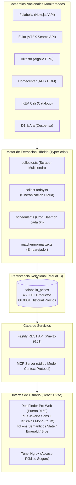

# DealFinder Pro 🇨🇴 — Plataforma Nacional de Inteligencia de Compras y Comparación de Ofertas


Plataforma integral de **Shopping Intelligence & Editorial FinTech** diseñada para recopilar, normalizar, auditar y comparar en tiempo real productos y ofertas de los principales comercios nacionales de Colombia (**Falabella, Éxito, Alkosto, Homecenter, IKEA Cali, Tiendas D1 y Tiendas Ara**).

A través de un motor híbrido de extracción multitienda (*Fast-First APIs + Playwright*), almacenamiento relacional en **MariaDB**, un comparador algorítmico (*Cross-Store Matcher*) y una interfaz moderna sin sobrecarga visual (*"anti-slop" design*, estilo *Stripe / Wirecutter / Klarna*), **DealFinder Pro** permite a los usuarios descubrir ahorros reales, auditar descuentos inflados y encontrar el mejor precio garantizado.

---

## 🚀 Arquitectura y Tecnologías



### Stack Técnico

* **Frontend:** React 18, TypeScript, Vite, Tailwind CSS, Google Fonts (`Plus Jakarta Sans` para UI y `JetBrains Mono` con números tabulares `tabular-nums` para precios alineados), sistema de iconografía SVG pura inline (`aria-hidden="true"`).
* **Backend:** Fastify 5 (+ `@fastify/cors`), TypeScript nativo (`tsx`).
* **Base de Datos:** MariaDB / MySQL 10.4+ (`mysql2`), índices optimizados, particionamiento lógico, hashing de estado de precios (`price_hash`) y transacciones seguras con reintento automático ante deadlocks de InnoDB.
* **Extracción y Scrapers:** Fast-First Hybrid:
  * Extracción directa de APIs (VTEX para Éxito, Algolia para Alkosto, JSON `__NEXT_DATA__` para Falabella, catálogo IKEA).
  * Fallback automático a **Playwright** (Chromium headless) con bloqueo de recursos estáticos innecesarios para máxima velocidad.
* **Inteligencia de Ofertas:** Algoritmo de detección de ofertas reales (`analyzer.ts`), comparación cruzada frente al precio tachado y frente a la media móvil de 30 días (`avg30`), cálculo de puntaje (`deal_score`) y emparejador multitienda (`match.ts`).
* **Integración IA:** Servidor **MCP (Model Context Protocol)** bajo `@modelcontextprotocol/sdk` para conectar asistentes y agentes inteligentes directamente con el inventario de ofertas.
* **Túnel y Acceso Remoto:** Configuración persistente de **ngrok** para compartir el entorno local mediante URLs públicas SSL.

---

## 🛍️ Cobertura de Comercios (7 Tiendas Nacionales)

| Comercio | Modalidad de Extracción | Cobertura de Catálogo |
|---|---|---|
| **Falabella** | Next.js Data JSON + Playwright fallback | Electrohogar, Tecnología, Muebles, Moda |
| **Éxito** | VTEX Catalog API (con segmentación regional Cali/Nal) | Supermercado, Tecnología, Celulares, Hogar |
| **Alkosto** | Algolia Search Direct Engine | Laptops, Smartphones, Televisores, Electrodomésticos |
| **Homecenter** | API JSON + Fallback DOM | Muebles, Iluminación, Herramientas, Tecnología |
| **IKEA Cali** | Catalog Search API | Muebles, Lámparas, Decoración, Dormitorio |
| **Tiendas D1** | Catálogo estructurado de marcas propias | Abarrotes, Despensa básica, Aseo |
| **Tiendas Ara** | Catálogo estructurado de ahorro diario | Alimentos, Lácteos, Granos, Bebidas |

---

## ✨ Características Principales de la Plataforma

1. **Diseño Editorial FinTech ("Anti-Slop"):**
   * Paleta sobria basada en tokens semánticos: Fondos Slate 50 (`#F8FAFC`), tarjetas blanco puro elevadas, acentos de ahorro inteligente en Emerald 600 (`#059669`) y acciones tecnológicas en Blue 600 (`#2563EB`).
   * Cero elementos de "cuponera barata": sin tipografías llamativas, sin banners parpadeantes, sin popups intrusivos.
2. **Números Tabulares (`tabular-nums`):**
   * Configuración CSS `font-feature-settings: "tnum"` en `JetBrains Mono` que asegura que los dígitos de precios de distintas tiendas queden alineados verticalmente sin saltos horizontales.
3. **Filtros Dinámicos e Inmediatos:**
   * **Chips Activos:** Barra superior que muestra los filtros seleccionados (`[Tecnología ✕]`, `[Descuento > 30% ✕]`, `[Falabella ✕]`) con botón de limpieza y recálculo instantáneo.
   * **Barra de Presets Rápidos (1 Clic):** Accesos directos a *«MacBook»*, *«iPhone»*, *«iPad»*, *«Rebajas > 40%»*, *«Menos de $100.000»*, *«Verificados Hoy»* y *«Eficiencia RETIQ A»*.
   * **Sidebar Modular:** Conteo dinámico de ofertas disponibles por tienda en tiempo real, selector de segmentos de descuento (`15%+`, `25%+`, `40%+`, `50%+`) y rangos numéricos de precio en COP.
   * **Drawer Móvil Táctil:** Bottom Sheet deslizable y accesible para pantallas de 360px a 768px.
4. **Tarjetas de Producto Estandarizadas:**
   * Proporción cuadrada limpia (`aspect-square`), badge del comercio, indicador de verificación (*"Verificado hoy"*), bloque de precio actual + original tachado y cálculo explícito del ahorro neto (*"Ahorras $X COP"*).
5. **Cero Layout Shift (CLS = 0):**
   * Sistema de esqueleto de carga animado (*ProductSkeletonGrid*) que replica milimétricamente la geometría de las tarjetas finales.
6. **Programación Automática (Daemon cada 6 Horas):**
   * Tarea cron continua que barre los catálogos periódicamente, actualiza la base de datos y recalcula el historial sin intervención humana.

---

## 📦 Instalación y Puesta en Marcha

### Requisitos Previos

* **Node.js** v20 o superior
* **MariaDB** o **MySQL** corriendo en `127.0.0.1:3306` (por ejemplo mediante XAMPP)
* **Git** instalado en el sistema

### 1. Clonar el Repositorio

```bash
git clone https://github.com/Huesly/DiscountPrice.git
cd DiscountPrice
```

### 2. Instalar Dependencias

```bash
# Dependencias principales (backend, colector, matcher, mcp)
npm install

# Dependencias del frontend web
cd web
npm install
cd ..
```

### 3. Variables de Entorno (`.env`)

Crea tu archivo `.env` a partir de la plantilla:

```bash
cp .env.example .env
```

Asegúrate de que los valores coincidan con tu entorno local:

```env
DB_HOST=127.0.0.1
DB_PORT=3306
DB_USER=root
DB_PASSWORD=
DB_NAME=falabella_prices

API_HOST=127.0.0.1
API_PORT=9151

MAX_PAGES=10
PAGE_DELAY_MS=600

SCHEDULE_CRON=0 */6 * * *
RUN_ON_START=true
```

### 4. Inicializar la Base de Datos

Ejecuta el script de inicialización para crear la base de datos `falabella_prices` y todas sus tablas (`products`, `price_history`, `deals`, `product_groups`, `group_members`):

```bash
npm run init-db
```

---

## 🛠️ Comandos Disponibles

### Servidores y Aplicación

| Comando | Descripción |
|---|---|
| `npm run api` | Inicia el servidor backend Fastify en `http://127.0.0.1:9151` |
| `npm --prefix web run dev` | Inicia la interfaz web React + Vite en `http://localhost:9150` |
| `npm --prefix web run build` | Compila el bundle de producción del frontend web |
| `npm run schedule` | Inicia el daemon programador automático (ejecución cada 6 horas) |
| `npm run mcp` | Inicia el servidor Model Context Protocol (MCP) por stdio |

### Extracción y Análisis de Datos

| Comando | Descripción |
|---|---|
| `npx tsx src/collect-today.ts` | Sincronización completa de precios del día (todas las tiendas y matcher) |
| `npm run collector` | Barre Falabella y términos de búsqueda definidos en `terms.txt` |
| `npm run collector:1` | Barre únicamente el Grupo 1 de términos en paralelo |
| `npm run collector:2` | Barre únicamente el Grupo 2 de términos en paralelo |
| `npm run collector:exito:cali` | Barre el catálogo de Éxito para la región de Cali |
| `npm run collector:homecenter` | Barre el catálogo de Homecenter |
| `npm run collector:ikea` | Barre el catálogo de muebles e iluminación de IKEA Cali |
| `npm run analyze` | Audita las variaciones de precios y genera las ofertas en la tabla `deals` |
| `npm run match` | Ejecuta el algoritmo de emparejamiento de productos idénticos entre tiendas |
| `npm run dedupe` | Limpia registros redundantes en el historial de precios |

---

## 🌐 Despliegue con Túnel Público (Ngrok)

Para compartir la plataforma local hacia el exterior (móviles, clientes o evaluadores):

1. Configura tu authtoken en `ngrok-secondary.yml`:
   ```yaml
   version: "2"
   authtoken: TU_TOKEN_DE_NGROK
   web_addr: 127.0.0.1:4044
   ```
2. Inicia el túnel apuntando al puerto del frontend:
   ```powershell
   ngrok http 127.0.0.1:9150 --config="ngrok-secondary.yml"
   ```
3. Accede mediante la URL asignada (ejemplo: `https://effort-salute-vice.ngrok-free.dev`).

---

## 📂 Estructura del Proyecto

```
DiscountPrice/
├── src/
│   ├── api/
│   │   └── server.ts          # API REST en Fastify (rutas /api/products, /api/stats, /api/collect)
│   ├── db/
│   │   ├── db.ts              # Pool de conexiones mysql2
│   │   ├── init.ts            # Inicializador de DDL
│   │   ├── repo.ts            # Repositorio y consultas SQL optimizadas
│   │   └── schema.sql         # Esquema de tablas relacionales
│   ├── discovery/             # Probes y exploradores de endpoints
│   ├── matcher/
│   │   └── normalize.ts       # Algoritmos de similitud textual y limpieza de títulos
│   ├── mcp/
│   │   └── server.ts          # Servidor MCP stdio para agentes IA
│   ├── stores/                # Adaptadores por tienda
│   │   ├── alkosto.ts         # Adaptador Algolia Engine
│   │   ├── ara.ts             # Adaptador Tiendas Ara
│   │   ├── d1.ts              # Adaptador Tiendas D1
│   │   ├── exito.ts           # Adaptador VTEX Search API
│   │   ├── falabella.ts       # Adaptador Next.js / Playwright
│   │   ├── homecenter.ts      # Adaptador Homecenter API
│   │   ├── ikea.ts            # Adaptador IKEA Cali
│   │   └── types.ts           # Tipos de adaptadores
│   ├── analyzer.ts            # Detección de gangas reales
│   ├── collect-today.ts       # Pipeline de extracción diaria multitienda
│   ├── collector.ts           # Motor principal de scraping y clasificación por categoría
│   ├── config.ts              # Configuración y parser de términos
│   ├── dedupe.ts              # Limpieza de duplicados
│   ├── match.ts               # Ejecutor del matcher multitienda
│   └── scheduler.ts           # Cron daemon cada 6 horas
├── web/                       # Aplicación Frontend React + Vite
│   ├── src/
│   │   ├── components/
│   │   │   ├── ActiveFilterChips.tsx   # Chips activos con eliminación y live counter
│   │   │   ├── DetailSheet.tsx         # Modal con histórico de precios
│   │   │   ├── Header.tsx              # Encabezado editorial con trust badge
│   │   │   ├── Icons.tsx               # Iconografía inline SVG pura
│   │   │   ├── MobileFilterDrawer.tsx  # Bottom sheet deslizable móvil
│   │   │   ├── Pagination.tsx          # Paginación con números tabulares
│   │   │   ├── ProductCard.tsx         # Tarjeta de producto estandarizada
│   │   │   ├── ProductGrid.tsx         # Grilla responsiva y empty state
│   │   │   ├── ProductSkeletonGrid.tsx # Skeletons animados anti-layout-shift
│   │   │   ├── QuickPresetsBar.tsx     # Presets de 1 clic (MacBook, iPhone, iPad, Rebajas)
│   │   │   └── SidebarFilters.tsx      # Barra lateral modular con live store counts
│   │   ├── hooks/                      # Custom hooks (filtros URL, favoritos)
│   │   ├── App.tsx                     # Orquestador del catálogo y vistas
│   │   └── index.css                   # Tokens semánticos CSS y sistema visual
│   └── index.html             # Google Fonts (Plus Jakarta Sans + JetBrains Mono)
├── terms.txt                  # Lista de términos clasificados en grupos
├── package.json               # Scripts y dependencias del backend
└── README.md                  # Documentación oficial del proyecto
```

---

## 📄 Licencia

Este proyecto es privado y para fines de monitoreo e inteligencia de precios en Colombia.
